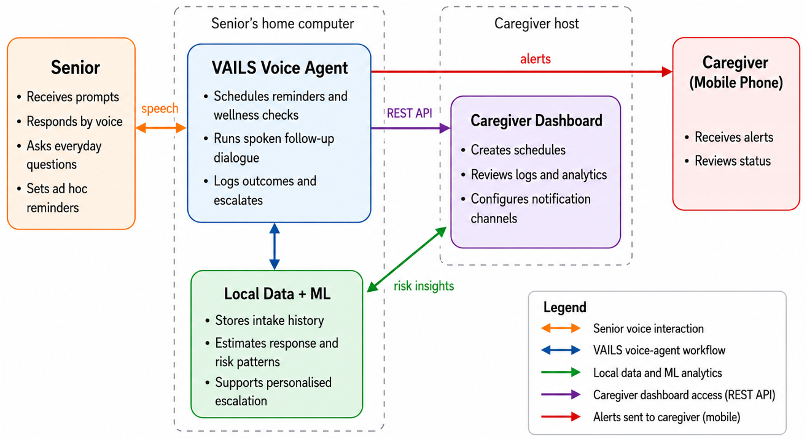
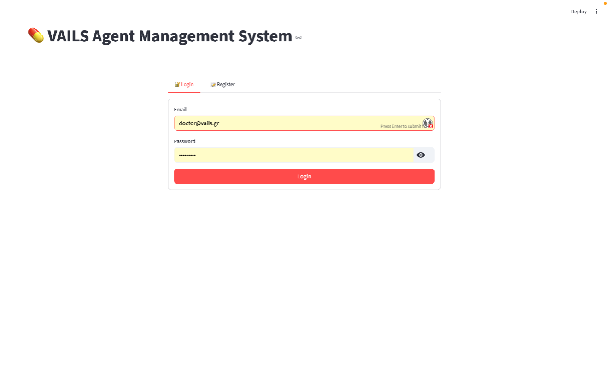
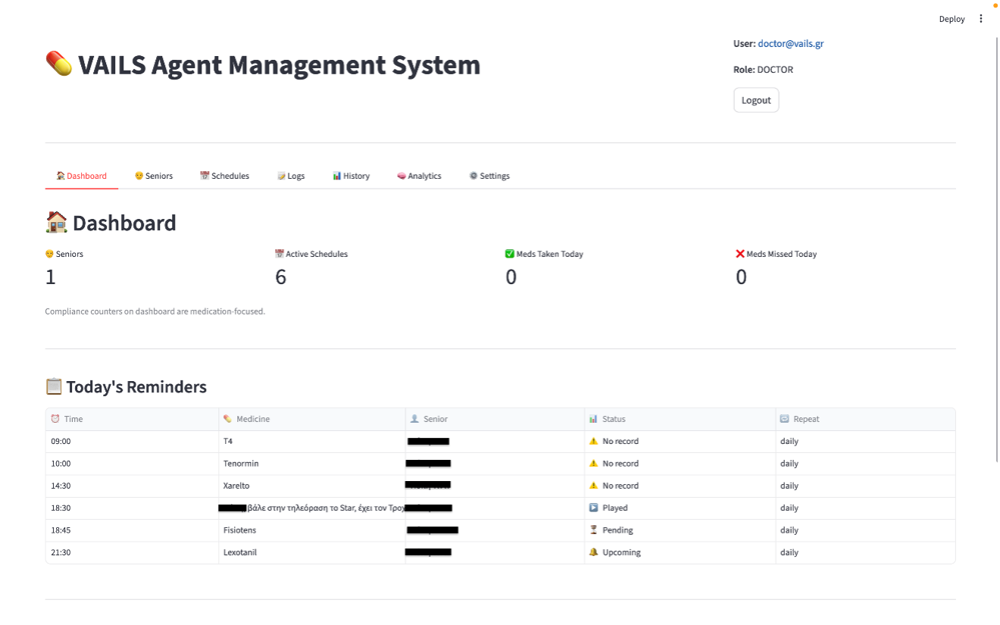
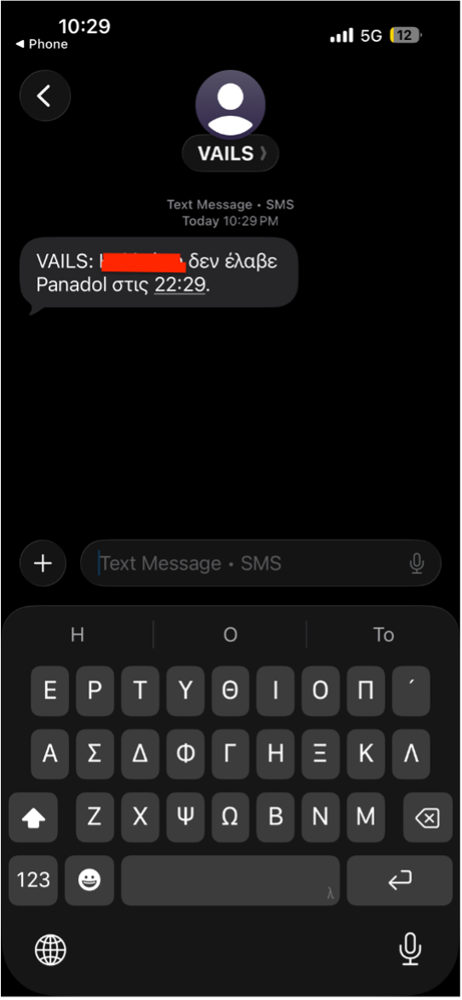

# VAILS — Voice Agent for Independent Living Support

A voice-first AI assistant that helps older adults live independently. Users simply talk to it: no screens, menus or apps to navigate. It reminds them about medication, checks in on how they're doing, and alerts caregivers when something needs attention.

> 📄 Bachelor's thesis, University of Macedonia. Paper accepted as a full paper at **BCI 2026** (12th Balkan Conference in Informatics), to appear in the Springer CSIS conference proceedings.
>
> 🔒 The source code is private. This repository is a project overview.

## The problem

Medication non-adherence is common among older adults, especially those with limited digital skills or cognitive decline. Most existing reminder tools assume the user can comfortably operate a smartphone app.

## What VAILS does

- **Natural voice conversation** in real time using the Gemini Live API, with voice activity detection for hands-free use
- **Medication reminders and wellness check-ins** through context-aware LLM dialogue
- **Risk detection** with scikit-learn models for medication-intake prediction, risk classification and behavioural clustering, to flag at-risk users early
- **Caregiver dashboard** so family members and doctors can stay in the loop, with role-based access (Admin / Doctor / Family)
- **Risk-aware escalation** via Telegram/SMS when intervention is needed

## Architecture

## Tech stack

Python · FastAPI · Gemini Live API · scikit-learn · SQLAlchemy / SQLite · APScheduler · Streamlit · JWT / bcrypt authentication

## Screenshots

## Publication

Paper accepted at BCI 2026, Thessaloniki. Link will be added once the proceedings are published.

## Author

**Kalliopi Maria Tintikaki** · [GitHub](https://github.com/kletin) · [LinkedIn](https://www.linkedin.com/in/kalliopi-maria-tintikaki-9182531a2/)

Supervised by Prof. Ioannis Refanidis, University of Macedonia.
